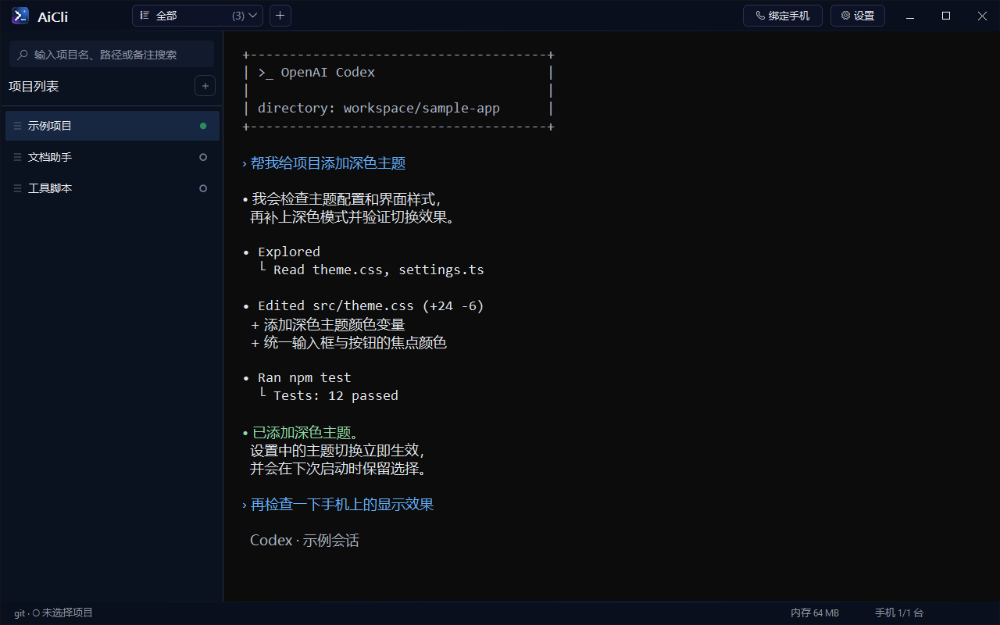
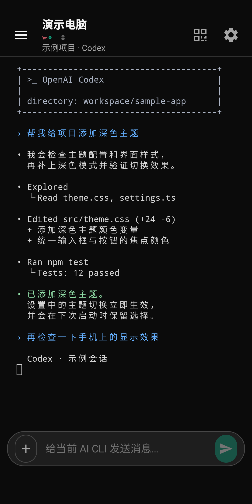
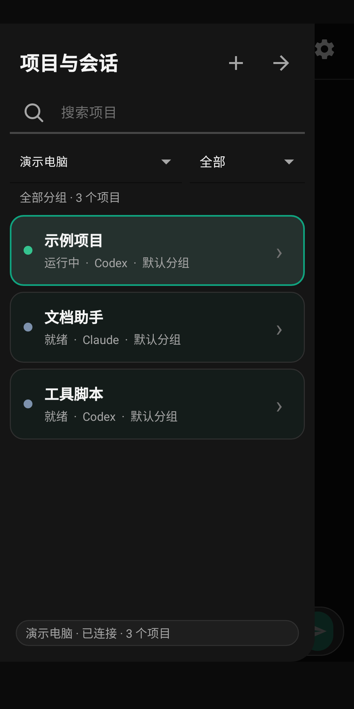

# AiCli

**Run Codex or Claude on your Windows PC. Follow the terminal and send the next instruction from your Android phone.**

[简体中文](README.md) · [Download](https://github.com/xwyjh3612/aicli/releases/latest) · [Feedback](https://github.com/xwyjh3612/aicli/issues) · [Contributing](CONTRIBUTING.md)

AiCli organizes command-line AI tools into projects with their own working directories, launch commands, groups, and notes. It runs them in an embedded Windows Terminal control. Pair an Android phone to read live output, send messages, upload images, and switch between projects on your PC.

I wanted to check Codex task progress from my phone while away from the PC, send a quick “continue,” or add another instruction. After looking around without finding a ready-made tool that fit my needs, I built AiCli. I have used it for several months, improving it as I go, and am now sharing it under the MIT license. If you have similar needs, I welcome you to try it and share feedback. The current interface is primarily in Chinese.

## Download

| Platform | Version | Installer |
| --- | --- | --- |
| Windows 10 20H1 or newer / Windows 11, x64 | 1.0.0.8 | [Windows installer](https://github.com/xwyjh3612/aicli/releases/latest/download/AI-CLI-Setup-1.0.0.8-x64.exe) |
| Android 8.0 or newer | 1.2.0 | [Android APK](https://github.com/xwyjh3612/aicli/releases/latest/download/AI-CLI-Android-1.2.0-release.apk) |

No source build is needed to try the release. Install and authenticate your preferred CLI separately, such as [Codex CLI](https://github.com/openai/codex) or [Claude Code](https://github.com/anthropics/claude-code). AiCli does not include a model service or a paid account; provider requirements and charges still apply. PowerShell 7 is recommended, with Windows PowerShell 5.1 as a fallback.

## What you can do

- Keep several coding projects and their launch commands in one workspace.
- Read terminal progress and send another instruction while away from the PC.
- Upload multiple images from your phone to a session.
- Resume existing CLI sessions through configurable project commands.
- See working status in the project list and Windows taskbar. Optionally keep the PC awake while a task is working.

The maintained desktop version uses native C++ / Win32, Windows Terminal TermControl, and Microsoft ConPTY. The repository also retains a Qt build path, which is not the default maintained version. Current supported targets are Windows and Android.

## Try it on your PC

1. Install AiCli and confirm that your AI CLI runs and is authenticated in PowerShell.
2. Click **＋** in the project list. Choose a name, CLI type, and working directory.
3. Review the launch command, save the project, and click **立即开始** (Start).

For a new Codex directory without a previous session, use `codex --no-alt-screen` as the project command. To resume a session later, use `codex --no-alt-screen resume --last`.

Built-in commands use Codex's `--yolo` or Claude's `--dangerously-skip-permissions`, which skip the CLI's operation confirmations. Remove those flags in the project or project-type settings if you want confirmations.

## Connect your phone

1. Keep the PC on with AiCli running, and connect both devices to the same trusted local network.
2. In **设置 → 本机与网络** (Settings → Computer and Network), enable **手机访问服务** (Phone access). Set the local address to the PC's actual LAN address, for example `https://192.168.1.10:4280`, then save. Use **配置防火墙** (Configure firewall) if Windows blocks the connection.
3. Click **绑定手机** (Pair phone). Scan the QR code with the Android app, then approve pairing on the PC.
4. Select a running project on the phone to view the terminal, send a message, or upload images with **＋** next to the message box.

Start with a shared local network. Connections across networks require your own VPN or another reachable route; there is no hosted relay. The Android app accesses the PC's terminal and does not run Codex independently. A sleeping or disconnected PC cannot serve the session.

## Preview

These images use demo projects and simulated conversation content. The desktop Codex image is a UI rendering example; the Android images come from a separate demo app. Edits and test results shown in the conversation are illustrative.

<table>
  <tr><th>Android terminal</th><th>Projects and sessions</th></tr>
  <tr>
    <td></td>
    <td></td>
  </tr>
</table>

## Feedback and development

Report installation, pairing, rendering, and update problems through [GitHub Issues](https://github.com/xwyjh3612/aicli/issues/new/choose). Include the app version, OS, steps, and expected versus actual behavior. Remove credentials and private conversation content from attachments.

See the [Chinese README](README.md) for build commands and implementation details, the [native module guide](desktop/src/NATIVE_MODULES.md), and [dependency configuration](tools/dependencies.md). To build the native desktop version, explicitly set `AICLI_USE_QT_UI=OFF`.

If AiCli is useful to you, a Star helps you find the project again and lets the author know it is being used.

## License

[MIT](LICENSE). Copyright © 2026 xwyjh3612. Third-party dependencies retain their own licenses.
