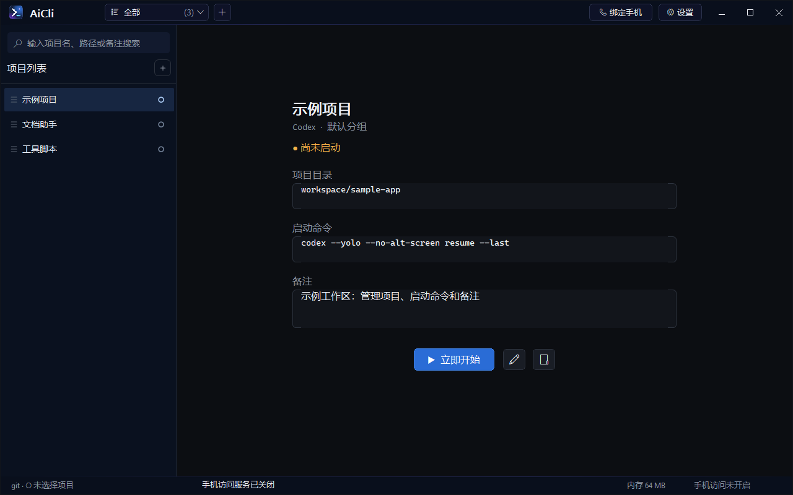
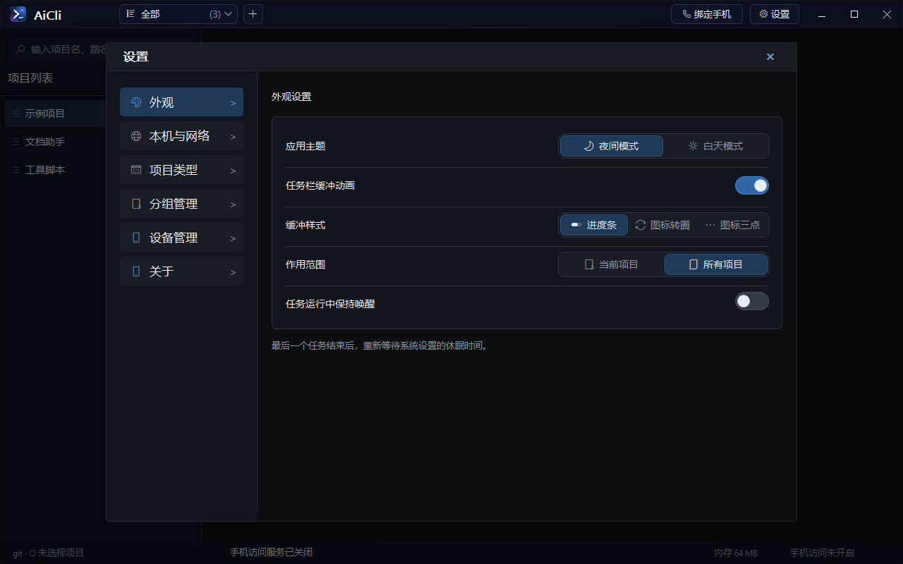
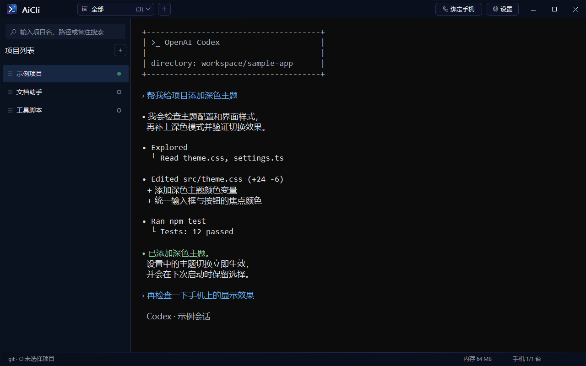
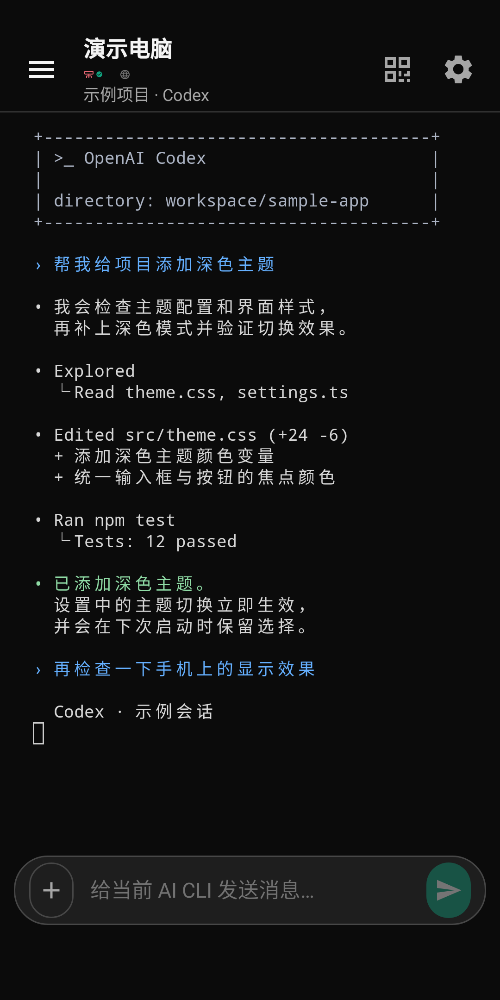
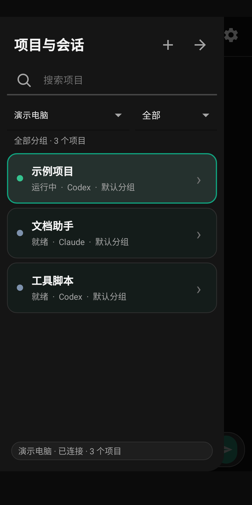

# AiCli

AiCli 是一个面向 Windows 的本地 AI 编程工作区，同时提供 Android 伴随客户端。它把 Codex、Claude 和其他命令行 AI 工具组织成可管理的项目，并在内嵌终端中运行；配对 Android 手机后，还可以通过局域网访问电脑上的项目、会话和实时终端。

当前仓库的主维护目标是非 Qt Win32 桌面版本。仓库仍保留 Qt UI 构建路径和 Android 客户端，但新功能和验证应优先覆盖非 Qt Win32 版本。

## 功能

- 管理项目、分组、项目类型、工作目录和启动命令。
- 内置 Codex、Claude 类型，也支持 Gemini 或其他自定义 CLI。
- 使用 Windows Terminal TermControl、XAML Island 和 Microsoft ConPTY 提供原生终端。
- 优先使用 PowerShell 7，未检测到或启动失败时回退 Windows PowerShell 5.1。
- 自动恢复 Claude 当前目录的最近会话；没有会话时创建新会话。
- 通过标题协议和通用终端输出检测 CLI 工作状态，在项目列表及任务栏显示动画。
- 使用 SQLite 保存项目、类型、分组、设备、设置和会话事件。
- Android 端支持扫码配对、HTTPS/WSS、终端同步、消息输入和多张图片上传；左侧“＋”随时展开功能菜单。
- 设置页显示应用版本和实际使用的 PowerShell 环境。
- Win32 桌面端和 Android 自动检查 GitHub Release 更新，校验安装包后提示安装。
- Win32 终端支持按住 Ctrl 单击网页链接，通过默认浏览器打开。

桌面端当前版本为 1.0.0.8，Android 端当前版本为 1.2.0（versionCode 3）。

最新安装包：[GitHub Releases](https://github.com/xwyjh3612/aicli/releases/latest)。

## 界面预览

以下为原生 Win32 桌面端与 Android 手机端的界面示例，使用演示项目与模拟会话内容。电脑端 Codex 图为界面渲染示例，手机端截图来自独立演示包；对话中的修改和测试结果仅用于展示界面。

**项目工作区**：管理项目、分组、工作目录、启动命令和备注。

**外观设置**：切换主题、配置任务栏动画和任务运行时保持唤醒。

**电脑端 Codex 会话**：在项目工作区查看终端输出与会话进度。

**手机端**：查看 Codex 实时终端并发送消息，也可通过项目抽屉切换电脑、分组和项目。

<table>
  <tr>
    <th>Codex 会话</th>
    <th>项目与会话列表</th>
  </tr>
  <tr>
    <td></td>
    <td></td>
  </tr>
</table>

## 自动更新

- Win32 版启动 10 秒后在后台检查，此后运行期间每 6 小时检查一次。也可在“设置 → 关于 → 检查更新”手动检查。
- 手动检查在“关于”页内显示进度和结果，不弹出检查窗口；发现新版时显示“下载更新”按钮。
- Android 在启动或返回前台时检查，成功检查后 6 小时内不重复请求。设置页提供“自动检查应用更新”开关和“检查更新”按钮。
- 检测到新版后先确认下载；显示下载进度并支持取消。下载完成后验证大小和 SHA-256，再确认安装。网络失败不会影响原有功能。
- Windows 安装器沿用已有的安装位置与数据，安装会关闭运行中的终端会话；安装前请保存工作。安装器可能显示 UAC 提示。
- Win32 终端以独立的 Windows Job 管理 PowerShell 和其启动的 CLI。关闭终端、退出应用或更新强制关闭应用时，一并结束该终端的子进程并释放会话占用。安装器升级旧版本时先获取目标安装目录的进程树，保留安装程序及其他安装目录的进程。
- Android 额外验证 APK 包名、版本号和签名与当前应用匹配，通过 FileProvider 交给系统安装器。首次更新需要允许 AiCli 安装应用，并确认系统安装提示。
- 1.0.0.3 / Android 1.1.0 及更早版本没有更新模块，需要手动安装一次新版。Qt 版本未接入自动更新。

更新源是公开的 `releases/latest/download/update-manifest.json`，不需要在客户端配置 GitHub token。只发布稳定版本，不向客户端推送草稿或预发布版本。发布方式见 [更新发布说明](tools/releasing.md)。

## 目录结构

~~~text
.
├─ desktop/                    Windows 桌面端（C++20）
│  ├─ src/                     应用、终端、Agent、数据和 UI 源码
│  ├─ tests/                   桌面端测试
│  ├─ tools/                   构建、运行时暂存和辅助脚本
│  ├─ installer/               Inno Setup 安装脚本
│  ├─ package/                 Appx 清单和打包资源
│  └─ assets/                  图标资源
├─ android-app/                Android Java/XML 客户端
├─ tools/                      仓库级辅助工具
├─ build-installer.bat         构建非 Qt Windows 安装包
└─ build-android-release.bat   构建 Android Release APK
~~~

## 环境要求

### Windows 桌面端

- Windows 10 20H1（10.0.19041）或更高版本，x64。
- Visual Studio 2022、MSVC 和 CMake 3.26+。
- Windows 10/11 SDK；当前工程使用 10.0.22621.0。
- Windows App SDK/WinRT、ConPTY、OpenSSL、CivetWeb 和 QR Code 依赖。
- PowerShell 7 推荐但不是必需；软件支持常规安装和 Microsoft Store 版，并可回退到 Windows PowerShell 5.1。

依赖路径使用本地配置 `dependencies.json`，该文件不提交到 Git。首次构建时复制
[`dependencies.example.json`](dependencies.example.json)，按本机环境填写依赖根目录；
配置方式见 [依赖配置说明](tools/dependencies.md)。仓库不要求固定的盘符或磁盘布局。

### Android 客户端

- JDK 17。
- Android SDK 35，最低 API 26。
- Gradle 8.2 和 Android Gradle Plugin 8.2.2。

## 构建非 Qt 桌面端

在仓库根目录执行：

~~~powershell
$cmake = 'cmake'
& $cmake -S desktop -B desktop\build -G 'Visual Studio 17 2022' -A x64 `
    '-DAICLI_USE_QT_UI=OFF' `
    '-DAICLI_SKIP_PACKAGED_ACTIVATION=OFF' `
    '-DAICLI_PACKAGE_IDENTITY_NAME=AiCli.Desktop.Debug' `
    '-DAICLI_APPLICATION_USER_MODEL_ID=AiCli.Desktop.Debug_jw3zr00rmb0ym!App' `
    "-DCMAKE_RUNTIME_OUTPUT_DIRECTORY=$((Join-Path (Get-Location) 'desktop/bin').Replace('\', '/'))"
& $cmake --build desktop\build --config Debug --target aicli -- /m:2
& .\desktop\tools\register-runtime.ps1 -Output .\desktop\bin\Debug
~~~

日常非 Qt 编译统一使用 `desktop/build`。Debug 使用独立的
`AiCli.Desktop.Debug` 包身份，注册后可与已安装的 Release 版本同时运行。
正式安装包仍使用安装包脚本的独立构建目录和 packaged activation 流程。

Qt UI 可通过 AICLI_USE_QT_UI=ON 构建。当前 Qt 开发环境和运行时注册细节参见 desktop/README.md。

## 构建 Windows 安装包

构建当前主维护的非 Qt 安装包：

~~~powershell
.\build-installer.bat
~~~

或直接执行：

~~~powershell
powershell.exe -NoProfile -ExecutionPolicy Bypass -File .\desktop\tools\build-windows-installer.ps1
~~~

脚本会构建 Release、暂存 Windows Terminal/WinUI/ConPTY 运行时、验证包身份，再通过 Inno Setup 生成安装程序和 SHA-256 文件。输出位于：

~~~text
release\AI-CLI-Setup-<版本>-x64.exe
release\AI-CLI-Setup-<版本>-x64.exe.sha256
~~~

构建 Qt 安装包时向脚本添加 -Qt 参数。

## 构建 Android Release

~~~powershell
.\build-android-release.bat --no-pause
~~~

或：

~~~powershell
powershell.exe -NoProfile -ExecutionPolicy Bypass -File .\android-app\tools\build-release.ps1
~~~

脚本会构建并验证签名 APK，生成 SHA-256，然后复制到 release/。正式签名配置使用以下环境变量：

~~~text
AICLI_RELEASE_KEYSTORE
AICLI_RELEASE_STORE_PASSWORD
AICLI_RELEASE_KEY_ALIAS
AICLI_RELEASE_KEY_PASSWORD
~~~

不要将 keystore、密码或 DPAPI 密钥文件提交到 Git。Android 正式版本必须继续使用同一签名密钥，才能覆盖升级已安装的应用。

## 测试

桌面端提供以下 CMake 测试目标：

- aicli_data_store_tests：SQLite 数据、默认类型迁移、项目与设备数据。
- aicli_terminal_stream_tests：终端 VT 流编码、快照和事件发布。
- aicli_terminal_working_detector_tests：Codex/Claude 状态检测、通用输出兜底和输入过滤。
- aicli_powershell_runtime_tests：PowerShell 7、Store 版入口和 5.1 回退。
- aicli_session_process_tests：真实 ConPTY/PowerShell 终端的关闭与强制退出、子进程文件锁释放、旧版安装清理及无关进程保留。
- aicli_ui_redraw_tests：模态窗口开关、设置页面切换、隐藏控件及局部缓冲绘制。
- aicli_styled_input_paint_tests：原生编辑框输入、选择、删除和主题切换的实际字形及前景色。
- aicli_qt_project_list_tests：Qt UI 开启时的项目列表测试。

构建非 Qt 测试：

~~~powershell
& $cmake --build desktop\build --config Debug --target aicli_data_store_tests aicli_terminal_stream_tests aicli_terminal_working_detector_tests aicli_powershell_runtime_tests -- /m:2
~~~

运行示例：

~~~powershell
& .\desktop\bin\Debug\aicli_terminal_working_detector_tests.exe
& .\desktop\bin\Debug\aicli_terminal_stream_tests.exe
& .\desktop\bin\Debug\aicli_powershell_runtime_tests.exe
& .\desktop\bin\Debug\aicli_session_process_tests.exe .\desktop\installer\close-running-terminals.ps1
& .\desktop\bin\Debug\aicli_data_store_tests.exe "$env:TEMP\aicli-data-store-test.db"
~~~

aicli_data_store_tests 必须传入一个临时 SQLite 数据库路径。

`aicli_keep_awake_tests` 验证最后一个任务结束后重置系统休眠计时，且后续空闲刷新不会持续延后休眠。
`aicli_update_check_tests` 是联网集成测试，验证手动更新检查不会阻塞界面、弹出窗口，且设置页打开时也能完成检查。

“任务运行中保持唤醒”只在有任务工作时阻止自动休眠；最后一个任务结束或关闭该功能后，重新等待 Windows 电源设置规定的休眠时间，不修改系统电源计划。

## 终端运行时

桌面端将 Windows Terminal TermControl 与匹配版本的 Microsoft ConPTY/OpenConsole 并置部署。当前使用 ConPTY 1.24.260710001 和 x64 OpenConsole.exe。

不要随意替换为系统 CreatePseudoConsole/conhost.exe。Codex 等全屏 TUI 会使用内联历史和复杂 VT 重绘，匹配的 OpenConsole 运行时用于保留正确的滚动和绘制行为。

PowerShell 7 检测支持常规安装和 Microsoft Store 版。如未自动识别到，请把 pwsh.exe 所在文件夹加入 PATH。安装、升级或修改 PATH 后，请完全退出并重启 AiCli。

## Android 配对与远程 Agent

桌面端 Agent 默认监听 4280 端口并提供 HTTPS/WSS：

1. 在桌面设置中配置监听地址、端口和对外显示地址。
2. 使用 Android 客户端扫描桌面端二维码。
3. 在桌面端确认设备绑定。
4. 使用配对设备访问项目、会话和实时终端。

仓库不自动部署公网 Relay。公网访问需要自行配置 VPN、端口映射或反向代理。请只在可信网络开放 Agent 端口。

## 数据与安全

- 桌面数据保存在当前 Windows 用户的本地 AiCli 数据目录。
- Android 配对使用设备密钥和签名请求，并支持重放保护、输入租约和设备撤销。
- codex --yolo 和 claude --dangerously-skip-permissions 只关闭各 CLI 自身的确认，不会赋予应用 Windows 管理员权限。
- packaged desktop 当前运行在 mediumIL，不应将远程 Agent 当作管理员权限代理。
- 不要提交证书、二维码内容、签名材料或其他本地凭据。

## 开发约定

- 非 Qt Win32 是当前主维护路径；除非任务明确要求，不要修改 qt_* 源文件。
- 调整终端链路前先阅读 desktop/README.md 和运行时暂存脚本。
- 桌面版本号以 desktop/package/AppxManifest.xml 为单一来源，CMake 会生成 UI 使用的版本常量。
- 构建缓存、暂存运行时和签名材料不应提交到 Git；指定的 `release` 安装包和校验文件保留在版本管理中，便于其他电脑直接安装。
- 提交前建议运行 git diff --check 和 git status --short。

## 相关文档

- desktop/README.md：桌面构建和 Windows Terminal 运行时细节。
- android-app/README.md：Android 客户端和 Release 构建说明。
- tools/dependencies.md：本地依赖配置和环境变量说明。
- ai-cli-mobile-architecture.md：桌面 Agent 与移动端架构。
- 开发上下文备份-2026-08-18.md：历史开发上下文备份。

## License

本项目采用 [MIT 许可证](LICENSE)，Copyright © 2026 xwyjh3612。
第三方依赖遵循各自的许可证。
